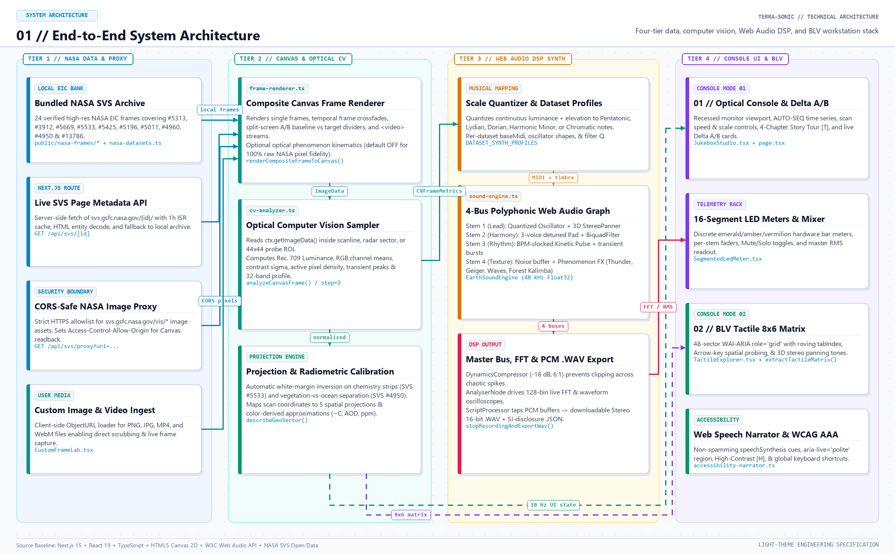
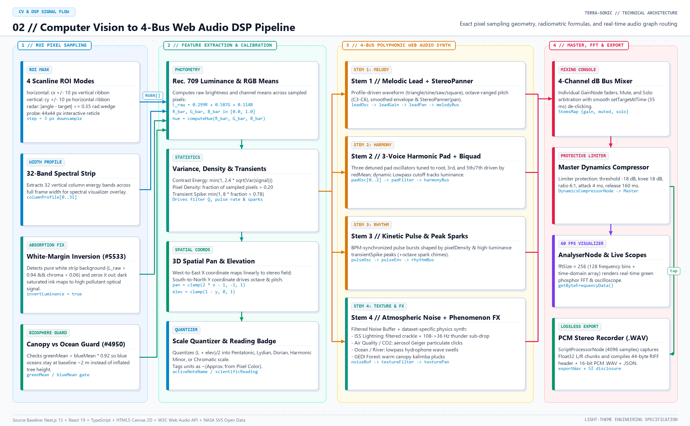
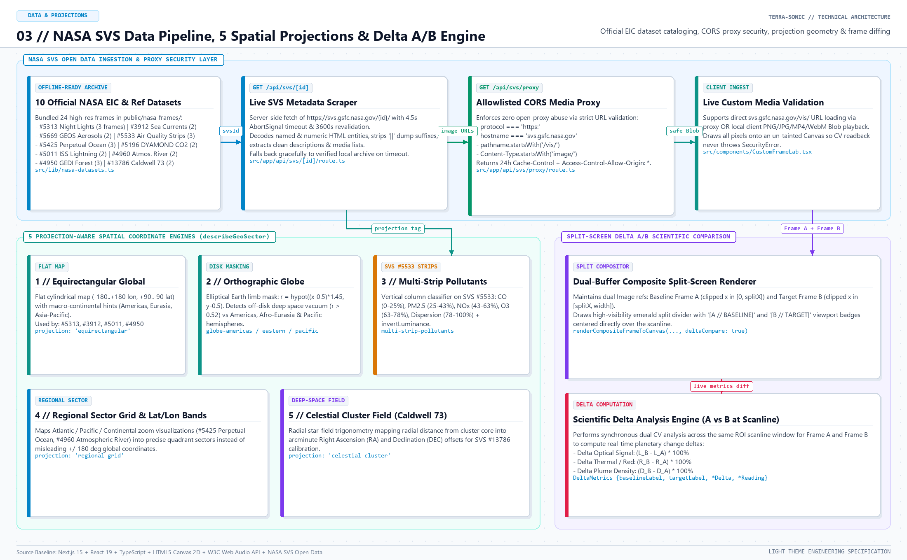
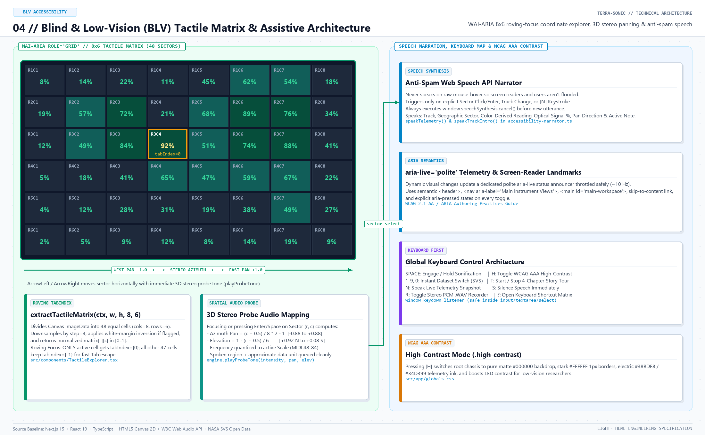
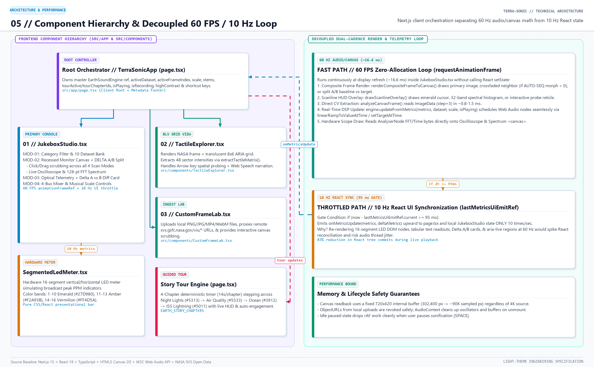
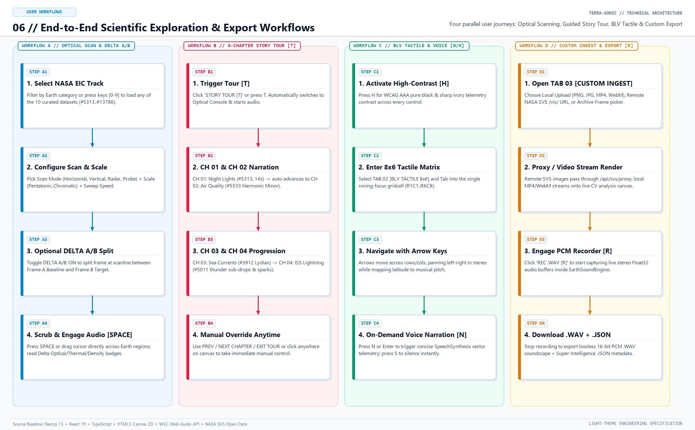

# TERRA-SONIC: The NASA Earth Information Jukebox

**Real-Time Optical Computer Vision, 4-Bus Web Audio Sonification, and Blind & Low-Vision (BLV) Spatial Exploration for NASA Earth Information Center (EIC) Imagery**

Live Application: [terra-sonic-earth-jukebox-nine.vercel.app](https://terra-sonic-earth-jukebox-nine.vercel.app/)



---

## Overview

**TERRA-SONIC** is an interactive scientific acoustic workstation built with **Next.js 15 App Router**, **TypeScript**, **HTML5 Canvas 2D**, and the **W3C Web Audio API**. It transforms authentic NASA Scientific Visualization Studio (SVS) Earth Information Center (EIC) datasets—as well as live proxied SVS assets and user-uploaded images/videos—into structured, polyphonic, accessible soundscapes computed directly from live pixel telemetry (`ctx.getImageData`).

### Key Capabilities
- **100% Procedural Audio (Zero Audio Samples):** Real-time 4-bus synthesis (`Melody Lead`, `3-Voice Harmonic Pad`, `Kinetic Pulse`, `Atmospheric Noise + Phenomenon FX`) quantized to Pentatonic, Lydian, Dorian, Harmonic Minor, or Scientific Chromatic scales, with **16-bit Stereo `.WAV` + `.JSON` export**.
- **24 Bundled NASA SVS Frames + Live Proxy:** Offline-ready frames covering `#5313`, `#3912`, `#5669`, `#5533`, `#5425`, `#5196`, `#5011`, `#4960`, `#4950`, and `#13786`, paired with `/api/svs/[id]` metadata resolution and `/api/svs/proxy` CORS-safe image retrieval.
- **Projection-Aware Coordinates & Scientific Calibration:** Distinguishes flat equirectangular projections, orthographic Earth globes (with off-disk space detection), regional zoomed basins, multi-strip chemistry charts (`#5533` optical absorption inversion), and celestial star clusters (`#13786`), while tagging all unit estimators explicitly as `(Approx. from Pixel Color)`.
- **`DELTA A/B` Split-Screen Analysis & 4-Chapter Story Tour:** Compare baseline vs. target frames directly at the scanline with synchronous luminance, thermal, and plume-density delta badges, or run the 4-Chapter Guided Earth Story Tour (`[T]`).
- **Blind & Low-Vision (BLV) First Design:** WAI-ARIA `grid`/`row`/`gridcell` `8×6` tactile coordinate matrix with roving `tabIndex`, 3D stereo panning probes, anti-spam Web Speech API narration (`[N]` / `[S]`), `aria-live="polite"` telemetry, global keyboard shortcuts, and WCAG AAA High-Contrast mode (`[H]`).

---

## Architecture & Visual Diagrams

All technical specifications and high-resolution diagrams live in [`docs/`](./docs/):

| Document | Focus | Embedded Diagram |
| --- | --- | --- |
| [`docs/ARCHITECTURE.md`](./docs/ARCHITECTURE.md) | System tiers, component hierarchy, 60 FPS / 10 Hz cadence & directory structure | [`01-system-architecture.png`](./docs/diagrams/01-system-architecture.png) · [`05-ui-component-and-render-loop.png`](./docs/diagrams/05-ui-component-and-render-loop.png) |
| [`docs/CV_DSP_ENGINE.md`](./docs/CV_DSP_ENGINE.md) | Canvas ROI masks, Rec. 709 CV formulas, 4-bus DSP graph, phenomenon layers & `.WAV` RIFF export | [`02-cv-to-dsp-pipeline.png`](./docs/diagrams/02-cv-to-dsp-pipeline.png) |
| [`docs/DATA_PIPELINE_AND_PROJECTIONS.md`](./docs/DATA_PIPELINE_AND_PROJECTIONS.md) | 24 SVS frames, `/api/svs/[id]` scraper, allowlisted proxy, 5 coordinate projections & `DELTA A/B` engine | [`03-data-pipeline-and-projections.png`](./docs/diagrams/03-data-pipeline-and-projections.png) |
| [`docs/ACCESSIBILITY_AND_BLV_DESIGN.md`](./docs/ACCESSIBILITY_AND_BLV_DESIGN.md) | WAI-ARIA `8×6` grid, roving `tabIndex`, stereo probe math, Web Speech & WCAG AAA shortcuts | [`04-blv-accessibility-matrix.png`](./docs/diagrams/04-blv-accessibility-matrix.png) |

### CV → 4-Bus Web Audio DSP Signal Flow


### NASA SVS Data Pipeline, Projections & `DELTA A/B` Comparison


### BLV Tactile 8×6 Matrix & Accessibility Architecture


### Component Tree & Decoupled 60 FPS / 10 Hz Render Loop


### End-to-End Scientific Exploration & Export Workflows


---

## Supported NASA SVS Datasets (`public/nasa-frames/`)

| Channel | SVS ID | Dataset | Instrument / Domain | Scale / BPM |
| --- | --- | --- | --- | --- |
| `CH 01` | `#5313` | Change in Night Lights (2012–2023) | Suomi NPP VIIRS · Urban & Energy | Pentatonic / 112 |
| `CH 02` | `#3912` | Global Sea Surface Currents & Temperature | ECCO2 · Oceans & Thermal | Lydian / 92 |
| `CH 03` | `#5669` | GEOS Aerosols | GEOS-5 FP · Atmosphere & Air | Harmonic Minor / 104 |
| `CH 04` | `#5533` | Air Quality Model Runs | GEOS-CF · CO, PM2.5, NOₓ, O₃ | Harmonic Minor / 108 |
| `CH 05` | `#5425` | Perpetual Ocean 2: Western Boundary | ECCO · Marine Velocities | Lydian / 118 |
| `CH 06` | `#5196` | DYAMOND Global Carbon Dioxide | GEOS-5 (2 km) · Climate & Carbon | Dorian / 96 |
| `CH 07` | `#5011` | Lightning Events Detected from ISS | LIS · Optical Convective Storms | Pentatonic / 126 |
| `CH 08` | `#4960` | 3D Atmospheric River | GEOS-5 · Moisture Plume | Lydian / 88 |
| `CH 09` | `#4950` | GEDI Forest Height | ISS GEDI LiDAR · Biosphere | Pentatonic / 94 |
| `REF 00` | `#13786` | Data Sonification: Caldwell 73 | Optical Reference Calibration | Scientific Chromatic / 84 |

---

## Tech Stack

- **Framework:** Next.js `15.5` (App Router), React `19`, TypeScript `5`
- **Styling:** Tailwind CSS v4 with custom matte-graphite telemetry tokens & `.high-contrast` WCAG AAA theme
- **Computer Vision:** Client-side HTML5 Canvas 2D (`getImageData`) with projection-aware coordinate conversion and radiometric strip inversion
- **Audio DSP:** W3C Web Audio API (`OscillatorNode`, `BiquadFilterNode`, `StereoPannerNode`, `DynamicsCompressorNode`, `AnalyserNode`, stereo PCM `.WAV` encoder)
- **Accessibility:** WAI-ARIA `grid` with roving `tabIndex`, `aria-live="polite"`, Web Speech API (`window.speechSynthesis`), and full keyboard navigation (`Space`, `1–9`, `0`, `T`, `R`, `N`, `S`, `H`, `Arrow Keys`, `?`)

---

## Running Locally

```bash
npm install
npm run typecheck
npm run build
npm run dev
```

Open [http://localhost:3000](http://localhost:3000) in a modern browser.

---

## Data Attribution & Super Intelligence Disclosure

- Earth science visualizations and dataset metadata are sourced from NASA Goddard Space Flight Center's Scientific Visualization Studio (`https://svs.gsfc.nasa.gov/`) and attributed strictly in plain text and official URLs without NASA logos or mission insignias.
- Assisted by Super Intelligence (SI) tooling during software architecture, Web Audio DSP engineering, documentation authoring, and UI refinement. All `.json` exports alongside recorded `.wav` audio include transparent SI disclosure metadata.
