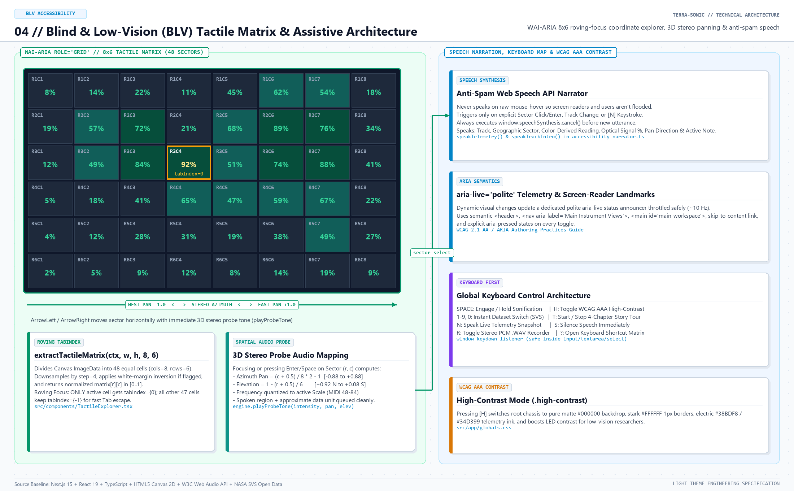

# Blind & Low-Vision (BLV) Accessibility & Tactile Design

## 1. Accessibility Philosophy

TERRA-SONIC treats Blind and Low-Vision (BLV) access as a core architectural foundation rather than an overlay. Every interactive feature in `JukeboxStudio`, `TactileExplorer`, and `CustomFrameLab` is operable exclusively via keyboard navigation, exposes structured WAI-ARIA landmarks and `aria-live="polite"` telemetry, pairs spatial coordinates with stereo panning + quantized audio cues, and avoids overlapping speech synthesis floods.

---

## 2. WAI-ARIA 8×6 Tactile Coordinate Matrix (`src/components/TactileExplorer.tsx`)

When switched to **`02 // BLV TACTILE 8×6`**, the active NASA visualization (scaled onto Canvas 2D) is sampled by `extractTactileMatrix(ctx, width, height, 8, 6, invertLuminance)` into **48 discrete sectors** (`6 rows × 8 columns`).

### 2.1 Roving `tabIndex` Grid Pattern
To follow the WAI-ARIA Authoring Practices Guide for composite `grid` widgets without forcing keyboard users through 48 sequential `Tab` stops:
- Container declares `role="grid"`, `aria-rowcount={6}`, `aria-colcount={8}`.
- Each row declares `role="row"`, `aria-rowindex={r + 1}`.
- Each sector button (`R1C1`..`R6C8`) declares `role="gridcell"`, `aria-colindex={c + 1}`, descriptive `aria-label` (sector coordinates + optical intensity % + region description), and dynamic `tabIndex`:
  - Only the currently focused cell holds `tabIndex={0}`.
  - The other 47 cells hold `tabIndex={-1}` so `Tab` moves cleanly into or out of the grid in a single keystroke.

### 2.2 Spatial Arrow Navigation & 3D Stereo Probe Audio
Pressing `ArrowUp`, `ArrowDown`, `ArrowLeft`, `ArrowRight`, `Home`, or `End` moves focus across cells with zero page scrolling and triggers `EarthSoundEngine.playProbeTone(intensity, pan, elevation)`:
- **Horizontal Azimuth (West → East):** $\text{pan} = \frac{c + 0.5}{8}\cdot 2 - 1 \in [-0.875,\; +0.875]$
- **Vertical Elevation (South → North):** $\text{elevation} = 1 - \frac{r + 0.5}{6} \in [+0.083,\; +0.917]$
- **Intensity:** Sector optical signal `[0.0, 1.0]` controls amplitude and harmonic timbre while elevation selects octave and quantized scale degree.

---

## 3. Anti-Spam Web Speech API Narration (`src/lib/accessibility-narrator.ts`)

Screen-reader and low-vision workflows break down if mouse hover floods `window.speechSynthesis` with stale queue items. TERRA-SONIC enforces strict narration discipline:
1. **No Raw Hover Speech:** Pointer hover updates visual coordinates quietly without triggering `speechSynthesis`.
2. **Explicit Invocation Only:** Narration runs strictly upon:
   - Explicit sector `Click`, `Enter`, or `Space` inside the `8×6` Tactile Matrix.
   - Switching active datasets or chapters.
   - Pressing `N` (*Speak Telemetry Snapshot*).
3. **Instant Queue Reset:** `speakText()` calls `window.speechSynthesis.cancel()` prior to enqueuing each utterance, and pressing `S` invokes `stopSpeaking()` to silence output immediately.
4. **Spoken Output Format:** Announces channel title, projection-accurate spatial sector, color-derived reading, normalized optical signal %, stereo channel direction (*left*, *right*, or *center*), and active quantized note/chord.

---

## 4. Global Keyboard Control Matrix (`src/app/page.tsx`)

All global shortcuts ignore keystrokes when focus resides inside form fields (`<input>`, `<textarea>`, `<select>`):

| Key / Shortcut | Action |
| --- | --- |
| `Space` | Engage or hold real-time optical sonification |
| `1` – `9`, `0` | Instant channel switch across `CH 01–09` and `REF 00` (`#13786`) |
| `T` | Start or stop the 4-Chapter Guided Earth Story Tour |
| `R` | Toggle real-time 16-bit Stereo PCM `.WAV` + `.JSON` recorder |
| `N` | Narrate live telemetry snapshot via Web Speech API |
| `S` | Silence all active Web Speech synthesis immediately |
| `H` | Toggle WCAG AAA High-Contrast Mode (`.high-contrast`) |
| `Arrow Keys` | Traverse `8×6` tactile coordinate grid (inside `BLV Tactile 8×6`) |
| `?` | Open or dismiss keyboard shortcut reference modal |

---

## 5. WCAG AAA High-Contrast Mode (`[H]`)

Toggling `[H] CONTRAST` applies the `.high-contrast` CSS token overrides defined in `src/app/globals.css`:
- Shifts matte charcoal panels to stark `#000000` background wells.
- Upgrades subtle `1px` hairlines to crisp `#FFFFFF` high-contrast borders.
- Increases telemetry indicator legibility and LED contrast while preserving exact layout proportions and keyboard focus rings (`:focus-visible`).
