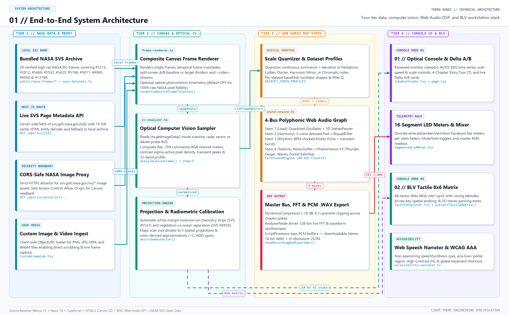
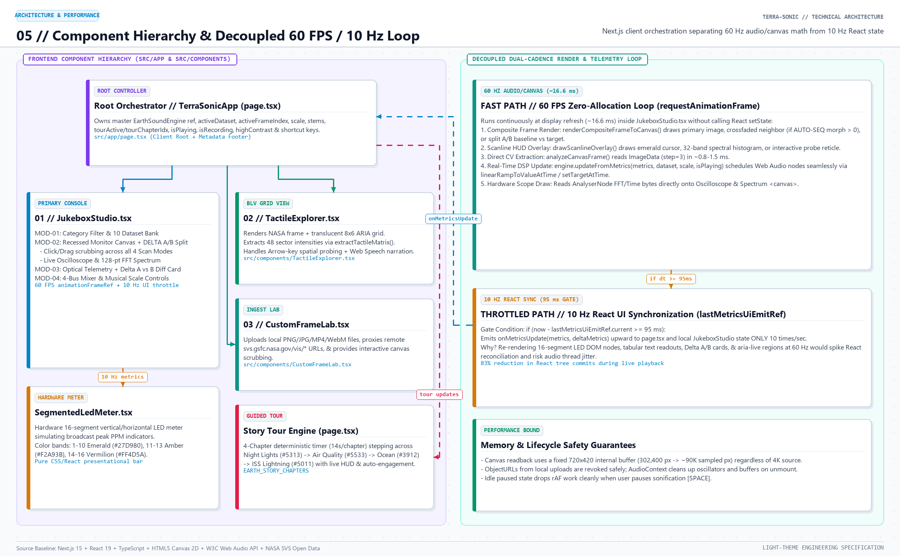
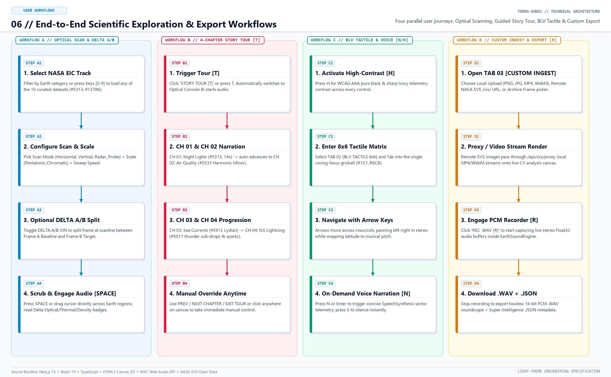

# TERRA-SONIC System Architecture



## 1. Architectural Overview

**TERRA-SONIC** is built as a client-heavy scientific acoustic workstation using **Next.js 15 App Router**, **React 19**, **TypeScript**, **HTML5 Canvas 2D**, and the native **W3C Web Audio API**. Rather than relying on pre-rendered audio files or opaque external audio libraries, all soundscapes are computed directly in real time from raw pixel telemetry (`ctx.getImageData`) sampled across authentic Earth observation imagery and custom video streams.

The system is organized into four cleanly decoupled tiers:

| Tier | Responsibility | Core Modules |
| --- | --- | --- |
| **Tier 1: Data & Proxy** | Serves 24 bundled NASA EIC frames, scrapes live SVS metadata pages, enforces HTTPS allowlisted CORS proxying, and loads client-side video/image blobs. | `public/nasa-frames/*`, `src/lib/nasa-datasets.ts`, `src/app/api/svs/[id]/route.ts`, `src/app/api/svs/proxy/route.ts`, `src/components/CustomFrameLab.tsx` |
| **Tier 2: Canvas & Optical CV** | Composites primary/comparison frames and `<video>` streams onto an offscreen-bounded `720×420` canvas, extracts normalized color/spatial metrics, and applies radiometric calibration. | `src/lib/frame-renderer.ts`, `src/lib/cv-analyzer.ts` |
| **Tier 3: 4-Bus Web Audio DSP** | Quantizes optical metrics into musical scales, schedules 4 parallel Web Audio stems + phenomenon-specific physics layers through a protective limiter, renders live FFT/oscilloscope buffers, and exports 16-bit stereo `.WAV`. | `src/lib/sound-engine.ts` |
| **Tier 4: Workstation UI & BLV** | Coordinates console workspaces, 4-Chapter Guided Tour, 16-segment hardware LED meters, WAI-ARIA `grid` tactile probing, Web Speech narration, and WCAG AAA High-Contrast visuals. | `src/app/page.tsx`, `src/components/JukeboxStudio.tsx`, `src/components/TactileExplorer.tsx`, `src/components/SegmentedLedMeter.tsx`, `src/lib/accessibility-narrator.ts` |

---

## 2. Frontend Component Hierarchy & Dual-Cadence Loop



To prevent DOM reconciliation and React state churn from starving real-time Web Audio scheduling, `JukeboxStudio.tsx` separates work into two distinct cadences:

1. **Fast Path (~60 FPS `requestAnimationFrame`):**
   - Renders the active frame (`renderCompositeFrameToCanvas`) or custom video stream (`renderVideoToCanvas`).
   - Draws visual telemetry overlays (`drawScanlineOverlay`): scanline beam, 32-band spectral energy strip, radar sweep arc, or `44×44 px` probe reticle.
   - Runs pixel extraction (`analyzeCanvasFrame`) inside the active region-of-interest (`step = 3`).
   - Calls `EarthSoundEngine.updateFromMetrics()` so oscillator frequencies, filter cutoffs, stereo pan positions, and rhythmic pulses update smoothly via Web Audio parameter ramps (`setTargetAtTime` / `linearRampToValueAtTime`).
   - Reads byte frequency and waveform buffers from `AnalyserNode` (`fftSize = 256`) directly onto the oscilloscope and FFT `<canvas>` elements with zero React re-renders.

2. **Throttled Path (~10 Hz React State Sync):**
   - Gates `onMetricsUpdate(metrics, deltaMetrics)` behind a `>= 95 ms` check (`lastMetricsUiEmitRef`).
   - Updates tabular numeric readouts, `SegmentedLedMeter` bar components, `SCIENTIFIC DELTA ANALYSIS (A vs B AT SCANLINE)` badges, and `aria-live="polite"` accessibility labels smoothly without interfering with audio timing.

---

## 3. End-to-End Scientific Exploration Workflows



### Console Views
- **`01 // OPTICAL CONSOLE` (`JukeboxStudio.tsx`):** Category filtering across 10 curated NASA EIC/reference channels, `Horizontal` / `Vertical` / `Radar` / `Probe` scanning, `AUTO-SEQ` time-series playback with crossfade morphing, `DELTA A/B` split-screen comparison, optional optical `KINEMATICS` (default `OFF` for pure raw NASA pixel fidelity), and a hardware-style 4-bus mixer.
- **`02 // BLV TACTILE 8×6` (`TactileExplorer.tsx`):** Translates the active Earth visualization into a keyboard-navigable 48-sector WAI-ARIA `grid` (`R1C1`–`R6C8`) with 3D stereo audio probing and anti-spam Web Speech narration.
- **`03 // CUSTOM INGEST` (`CustomFrameLab.tsx`):** Supports drag-and-drop PNG/JPG images, client-side MP4/WebM video scrubbing, archive frame selection, and live CORS-proxied `https://svs.gsfc.nasa.gov/vis/...` imagery.

### Directory Map

```text
src/
├── app/
│   ├── api/
│   │   ├── svs/[id]/route.ts          # Live NASA SVS HTML metadata parser & fallback
│   │   └── svs/proxy/route.ts         # HTTPS allowlisted CORS-safe NASA SVS image proxy
│   ├── globals.css                    # Hardware instrument tokens + .high-contrast WCAG AAA theme
│   ├── layout.tsx                     # Root HTML metadata, fonts & viewport shell
│   └── page.tsx                       # Root client orchestrator, hotkeys & 4-Chapter Story Tour
├── components/
│   ├── CustomFrameLab.tsx             # Local PNG/JPG/MP4/WebM & live SVS URL ingestion lab
│   ├── JukeboxStudio.tsx              # 60 FPS canvas loop, 10 Hz React sync, DELTA A/B & 4-bus mixer
│   ├── SegmentedLedMeter.tsx          # Discrete 16-segment emerald/amber/vermilion hardware meter
│   └── TactileExplorer.tsx            # WAI-ARIA 8x6 roving-tabindex tactile audio grid
└── lib/
    ├── accessibility-narrator.ts      # Projection coordinate geometry & Web Speech API narrator
    ├── cv-analyzer.ts                 # Rec. 709 pixel sampler, unit estimators & 8x6 extractor
    ├── frame-renderer.ts              # Image/video compositor, split A/B mask & HUD overlays
    ├── nasa-datasets.ts               # 10 verified datasets & 24 frame variants registry
    ├── sound-engine.ts                # 4-bus Web Audio synth, phenomenon FX & WAV exporter
    └── types.ts                       # Shared TypeScript interfaces (CVFrameMetrics, DeltaMetrics, etc.)
```
