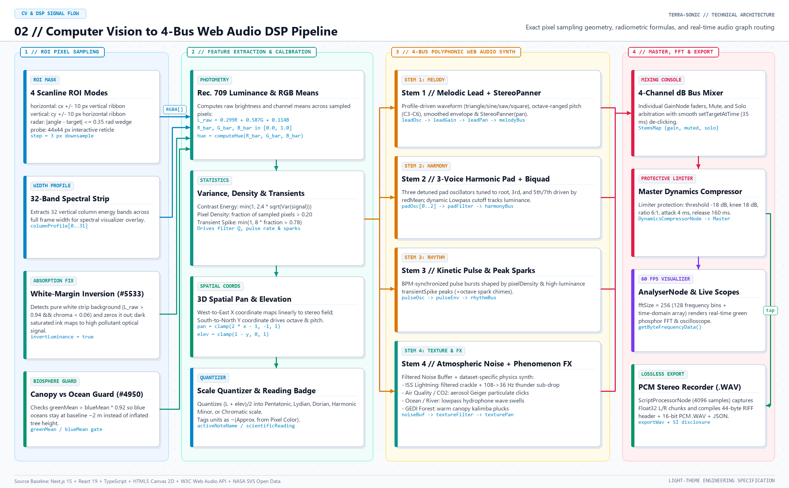

# Computer Vision & 4-Bus Web Audio DSP Engine



## 1. Computer Vision Pipeline (`src/lib/cv-analyzer.ts`)

Every active frame is drawn onto a `720×420` working HTML5 `<canvas>`. Rather than treating images as flat textures, `analyzeCanvasFrame()` restricts extraction to an active region-of-interest (ROI) controlled by `scanMode` and downsamples on a `step = 3 px` grid for deterministic sub-2 ms execution per frame.

### 1.1 ROI Geometry
| Scan Mode | Sampled Region Formula | Spatial Coordinate Mapping |
| --- | --- | --- |
| `horizontal` | Vertical slice `[cx - 10, cx + 10]` across full height | `normScanX = scanPosition`, `normScanY` = weighted luminance centroid |
| `vertical` | Horizontal slice `[cy - 10, cy + 10]` across full width | `normScanY = scanPosition`, `normScanX` = weighted luminance centroid |
| `radar` | Polar wedge `|atan2(y - h/2, x - w/2) - targetAngle| <= 0.35 rad` | `normScanX`, `normScanY` = energy-weighted centroid |
| `probe` | `44×44 px` square centered at user cursor `(probePoint.x, probePoint.y)` | Exact cursor `(probePoint.x, probePoint.y)` |

### 1.2 Radiometric Signal Formulas

For each sampled RGBA pixel `(r, g, b)` normalized to `[0.0, 1.0]`:

1. **Rec. 709 Optical Luminance:**
   $$L_{\text{raw}} = 0.299R + 0.587G + 0.114B$$

2. **White-Background Strip Inversion (`invertLuminance = true`, e.g., `SVS #5533`):**
   Multi-panel chemistry visualizations render high pollutant concentrations as dark/saturated ink on pure white margins. When enabled:
   $$\text{chroma} = \max(R, G, B) - \min(R, G, B)$$
   $$\text{signal} = \begin{cases} 0 & \text{if } L_{\text{raw}} > 0.94 \land \text{chroma} < 0.06 \\ \text{clamp}\bigl((1 - L_{\text{raw}})\cdot 0.65 + \text{chroma}\cdot 0.60,\; 0,\; 1\bigr) & \text{otherwise} \end{cases}$$

3. **Canopy vs. Ocean Filter (`SVS #4950` GEDI Forest Height):**
   To avoid false canopy height readouts over deep blue oceans, `formatScientificReading()` gates vegetation index on `greenMean > blueMean * 0.92`.

4. **Aggregate Statistical Features (`CVFrameMetrics`):**
   - **Contrast Energy:** $\text{contrastEnergy} = \min\left(1,\; 2.4 \cdot \sqrt{\max(0, \mathbb{E}[\text{signal}^2] - \bar{L}^2)}\right)$
   - **Pixel Density:** Fraction of sampled ROI pixels exceeding $\text{signal} > 0.20$
   - **Transient Spike:** $\min(1,\; 8 \cdot \text{fraction}(\text{signal} > 0.78))$
   - **3D Stereo Azimuth & Elevation:**
     $$\text{spatialPan} = \text{clamp}(2x - 1,\; -1,\; 1), \qquad \text{spatialElevation} = \text{clamp}(1 - y,\; 0,\; 1)$$
   - **Column Energy Profile:** 32 vertical column energy bands (`columnProfile[0..31]`) sampled every `8 px` vertically for the live spectral strip overlay.

> **Transparency Note on Physical Unit Readouts:** Physical metrics rendered alongside the console (`~ °C`, `~ AOD`, `~ µg/m³`, `~ m/s`, `~ ppm`, `~ kg/m/s`, `~ m Canopy`) are computed deterministically from normalized RGB/luminance ratios and explicitly labeled `(Approx. from Pixel Color)` or `(Color-Derived)` in the UI.

---

## 2. 4-Bus Polyphonic Web Audio Synthesizer (`src/lib/sound-engine.ts`)

`EarthSoundEngine` instantiates a zero-sample Web Audio graph driven strictly by `CVFrameMetrics` and per-dataset timbral configs (`DATASET_SYNTH_PROFILES`).

### 2.1 Scale Quantization
Continuous optical values `(luminance + spatialElevation) * 0.5` quantize onto discrete scale intervals (`SCALE_NOTES`):
- **Pentatonic:** `C, D, E, G, A` (urban corridors, lightning bursts, GEDI forest canopy)
- **Lydian:** `F, G, A, B, C, D, E` (ocean currents, atmospheric rivers)
- **Dorian:** `D, E, F, G, A, B, C` (DYAMOND global CO₂ carbon cycle)
- **Harmonic Minor:** `A, B, C, D, E, F, G#` (GEOS aerosols, air quality pollutant plumes)
- **Scientific Chromatic:** 12-tone equal temperament (`Caldwell 73` astronomical calibration)

### 2.2 Audio Routing Architecture

```text
  Stem 1 (Melody Lead) ──► BiquadFilter ──► leadPan (StereoPanner) ──► melodyGain ──┐
  Stem 2 (Pad Voices x3) ► padFilter (LPF tracking luminance) ──────► harmonyGain ─┼──► DynamicsCompressor
  Stem 3 (Kinetic Pulse) ─► BPM-clocked bursts + transient sparks ──► rhythmGain ──┤    (-18 dB, 6:1)
  Stem 4 (Noise + FX) ───► BiquadFilter ──► texturePan ─────────────► textureGain ─┘          │
                                                                                              ▼
                                          AnalyserNode (fftSize=256) ◄── MasterGain ──► Destination
                                                                              │
                                                                              ▼
                                                      ScriptProcessor (4096) ─► Stereo 16-bit .WAV
```

### 2.3 Dataset-Specific Timbre & Phenomenon Synthesis Layer
`DATASET_SYNTH_PROFILES` and `triggerPhenomenonLayer()` tailor timbral expression to each physical Earth phenomenon:
- **ISS Lightning (`iss-lightning`):** High-passed spark burst + deep thunder sub-drop oscillator sweeping `108 Hz → 36 Hz`.
- **Air Quality / Aerosols / CO₂ (`air-quality`, `geos-aerosols`, `dyamond-co2`):** Band-passed Geiger-style particulate clicks scaled by optical aerosol density.
- **Oceans & Atmospheric Rivers (`sea-currents-temp`, `perpetual-ocean`, `atmospheric-river`):** Low-pass filtered hydrophone fluid swell envelopes.
- **GEDI Forest Height (`gedi-forest`):** Warm wooden kalimba-like triangle plucks scaled by canopy height index.

### 2.4 Lossless Stereo `.WAV` + Metadata `.JSON` Export
When recording is active (`REC .WAV [R]`), `ScriptProcessorNode` captures interleaved Float32 left/right PCM chunks in memory. Stopping playback triggers `stopRecordingAndExportWav(dataset)`, which writes a standard 44-byte RIFF header, encodes signed 16-bit PCM stereo frames into a `.wav` file, and downloads an accompanying `.json` telemetry & Super Intelligence disclosure manifest.
