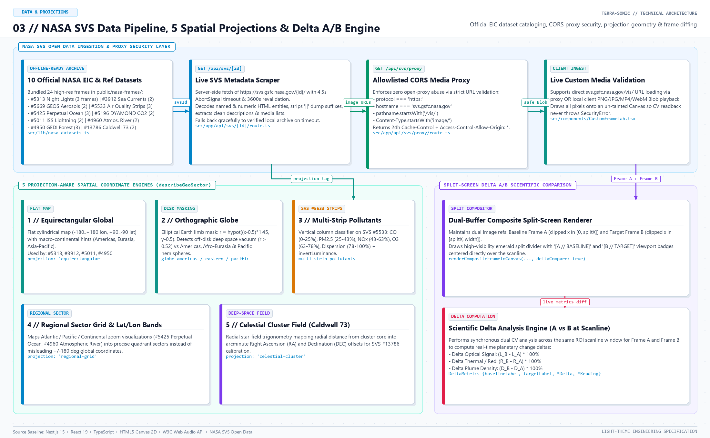

# NASA SVS Data Pipeline, Spatial Projections & Delta A/B Engine

## 1. NASA SVS Data Cataloging (`src/lib/nasa-datasets.ts`)

TERRA-SONIC includes **24 verified high-resolution frames** stored locally under `public/nasa-frames/`, organized across 9 official Earth Information Center (EIC) datasets plus the Caldwell 73 sonification calibration reference:

| Channel | SVS ID | Dataset Title | Frames | Projection Type | Default Scale / BPM |
| --- | --- | --- | --- | --- | --- |
| `CH 01` | `#5313` | Change in Night Lights (2012–2023) | 3 | `equirectangular` | Pentatonic / 112 |
| `CH 02` | `#3912` | Global Sea Surface Currents & Temp | 2 | `equirectangular`, `globe-eastern` | Lydian / 92 |
| `CH 03` | `#5669` | GEOS Aerosols | 2 | `globe-americas`, `globe-eastern` | Harmonic Minor / 104 |
| `CH 04` | `#5533` | Air Quality Model Runs | 3 | `multi-strip-pollutants`, `equirectangular` | Harmonic Minor / 108 |
| `CH 05` | `#5425` | Perpetual Ocean 2 | 3 | `regional-grid` | Lydian / 118 |
| `CH 06` | `#5196` | DYAMOND Global Carbon Dioxide | 2 | `globe-americas`, `globe-eastern` | Dorian / 96 |
| `CH 07` | `#5011` | ISS Lightning Events (2017–2023) | 2 | `equirectangular`, `globe-pacific` | Pentatonic / 126 |
| `CH 08` | `#4960` | 3D Atmospheric River | 2 | `regional-grid` | Lydian / 88 |
| `CH 09` | `#4950` | GEDI Forest Height | 3 | `equirectangular` | Pentatonic / 94 |
| `REF 00` | `#13786` | Data Sonification: Caldwell 73 | 2 | `celestial-cluster` | Scientific Chromatic / 84 |

---

## 2. Live Server Routes & Security Boundaries

### 2.1 Live SVS Metadata API (`GET /api/svs/[id]`)
Implemented in `src/app/api/svs/[id]/route.ts`:
- Fetches `https://svs.gsfc.nasa.gov/{id}/` with an `AbortSignal.timeout(4500)` guard and `next: { revalidate: 3600 }` hourly ISR caching.
- Parses OpenGraph/meta titles and descriptions, decodes named and numeric HTML entities (`&ndash;`, `&#x2014;`, etc.), strips raw file list suffixes (`split("||")[0]`), and extracts non-thumbnail `/vis/` `.jpg`/`.png` media paths.
- Falls back seamlessly to `verified-local-archive` metadata from `NASA_DATASETS` if upstream SVS is unreachable or times out.

### 2.2 CORS-Safe Media Proxy (`GET /api/svs/proxy?url=...`)
Implemented in `src/app/api/svs/proxy/route.ts` to prevent open-proxy vulnerabilities while keeping `<canvas>` pixel extraction free from `SecurityError` tainting:
1. Validates URL syntax via `new URL(targetUrl)`.
2. Enforces strict allowlist checks:
   - `parsed.protocol === "https:"`
   - `parsed.hostname === "svs.gsfc.nasa.gov"`
   - `parsed.pathname.startsWith("/vis/")`
3. Verifies upstream response headers have `Content-Type: image/*` (returns HTTP `415` otherwise).
4. Streams image bytes with `Access-Control-Allow-Origin: *` and `Cache-Control: public, max-age=86400`.

### 2.3 Client-Side Custom Image & Video Ingest (`src/components/CustomFrameLab.tsx`)
Supports local `.png`, `.jpg`, `.mp4`, and `.webm` files via browser `URL.createObjectURL`, allowing interactive video timeline scrubbing and continuous real-time Canvas CV analysis without uploading user media to external servers.

---

## 3. Projection-Aware Coordinate Engine (`describeGeoSector`)

Different NASA SVS assets use fundamentally different geometries. Treating an orthographic hemisphere or multi-pollutant comparison panel as a `-180°..+180°` equirectangular map creates false geographic readings. `describeGeoSector()` in `src/lib/accessibility-narrator.ts` adapts narration dynamically based on `FrameProjection`:

1. **`equirectangular`:** Full `-180°..+180°` longitude and `+90°..-90°` latitude conversion with macro-region hints (Americas, Africa/Europe, Asia-Pacific, Equatorial/Polar zones).
2. **`globe-americas` / `globe-eastern` / `globe-pacific`:** Computes elliptical disk radius `r = hypot((x - 0.5) * 1.45, y - 0.5)`. Regions where `r > 0.52 && signal < 0.1` are identified as **Deep Space Limb Margin (Off-Disk)** instead of bogus Earth coordinates.
3. **`multi-strip-pollutants` (`SVS #5533`):** Classifies horizontal bands into **Carbon Monoxide (`0–25%`)**, **PM2.5 (`25–43%`)**, **NOₓ (`43–63%`)**, **Tropospheric Ozone O₃ (`63–78%`)**, and **Eastern Dispersion (`78–100%`)** paired with Northern/Tropical/Southern bands.
4. **`regional-grid`:** Maps zoomed basin scenes (`#5425`, `#4960`) into regional sector quadrants and normalized lat/lon sub-bands.
5. **`celestial-cluster` (`#13786`):** Converts radial distance from image center into Right Ascension (RA) and Declination (DEC) arcminute offsets and identifies core vs. stellar halo regions.

---

## 4. Split-Screen `DELTA A/B` Scientific Comparison Engine

Available across multi-frame NASA datasets (`frames.length >= 2`) inside `JukeboxStudio.tsx`:
- **Visual Compositor (`renderCompositeFrameToCanvas`):** Clips **Frame A (`Baseline`)** to `x ∈ [0, splitX]` and **Frame B (`Target`)** to `x ∈ [splitX, width]`, synchronized to the interactive scanline or drag position with `[A // BASELINE]` and `[B // TARGET]` HUD markers.
- **Synchronous Delta Analysis (`DeltaMetrics`):** Runs dual ROI analysis along the same scanline coordinates for Frame A and Frame B, computing real-time change telemetry:
  - **Δ Optical Signal:** `(L_B - L_A) * 100%`
  - **Δ Thermal / Red:** `(R_B - R_A) * 100%`
  - **Δ Plume Density:** `(D_B - D_A) * 100%`
- **Acoustic Contrast:** Users can scrub horizontally across `[A // BASELINE]` vs `[B // TARGET]` to hear baseline vs. target planetary evolution side by side.
